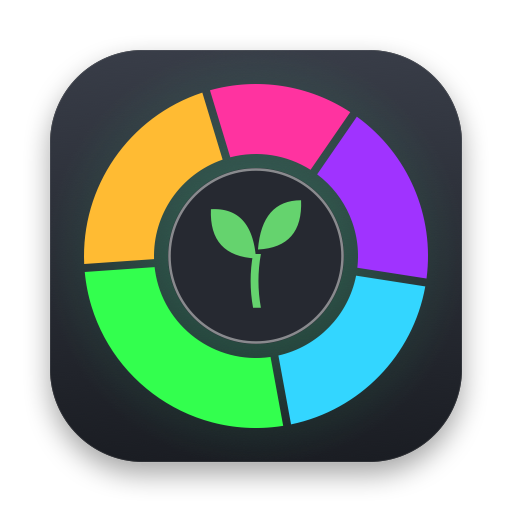
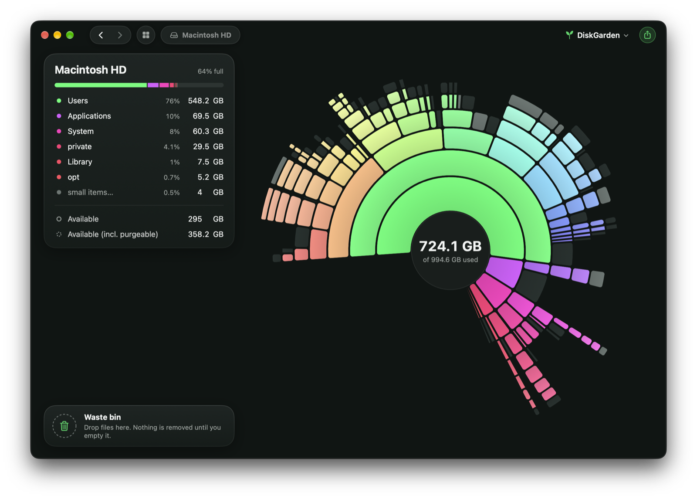

<p align="center">
  <a href="https://diskgarden.app"></a>
</p>

<h3 align="center">DiskGarden</h3>

<p align="center"><b>See what's eating your Mac.</b></p>

<p align="center">
  A free disk space analyzer for macOS. Every folder on your Mac becomes a bloom: spot what's big, drop it in the Waste
  bin and get your space back.
</p>

<p align="center">
  <a href="https://dl.diskgarden.app/DiskGarden.dmg"></a>
  &nbsp;
  <a href="https://diskgarden.app"></a>
</p>

<p align="center">
  <a href="https://diskgarden.app/releases/"></a>
  
  
  
  
</p>

<p align="center">
  <b><a href="https://dl.diskgarden.app/DiskGarden.dmg">Download</a></b> ·
  <a href="https://diskgarden.app">Website</a> ·
  <a href="https://diskgarden.app/user-guide/">User guide</a> ·
  <a href="https://diskgarden.app/releases/">Release notes</a> ·
  <a href="https://diskgarden.app/support/">Support</a>
</p>

<p align="center">
  
</p>

## Features

### The map

- **A bloom for every disk**: folders become rings, sized by the space they really use. Hover to see what's big,
  click to dig in, drag to clear.
- **Fast**: a whole startup disk in about 12 seconds. Folders are read in parallel, straight from the disk, about
  4× faster than `du` in Terminal.
- **Live updates**: the map follows your files as they change; only changed folders are re-read.
- **Remembers scans**: reopen the last result instantly.
- **Quick Look**: press Space to preview any file.

### Find the missing gigabytes

- **Deep Scan (Admin)**: see folders normal apps can't open: other users' home folders, protected system areas.
- **System Data, explained**: the mystery category, folder by folder.
- **Hidden space**: snapshots, purgeable space and other volumes, shown instead of left unexplained.
- **Available (incl. purgeable)**: know what macOS can reclaim by itself.
- **Accurate sizes**: real space on disk, hard links counted once.

### Safe by design

- **Waste bin**: drag anything big in, review sizes and paths, put back anything. Nothing is deleted until you empty
  it, and it goes to the Trash first.
- **System files can't go in at all.**
- **Not a cleaner**: no magic button. You decide what goes, so it's the big files you don't need, not caches that grow
  right back.

### And

- **Every disk**: internal or external, SSD or USB stick, network share, disk image, Time Machine.
- **Export to CSV**: take the numbers to a spreadsheet.
- **Light and dark**: follows your Mac, or pick one.
- **18 languages**: from Arabic to Ukrainian.
- **Free**: no trial, no account, no ads.

## Download

<a href="https://dl.diskgarden.app/DiskGarden.dmg"></a>

1. Download [`DiskGarden.dmg`](https://dl.diskgarden.app/DiskGarden.dmg) (always the latest version) or get it from
   [diskgarden.app/download](https://diskgarden.app/download/).
2. Open it and drag **DiskGarden** to **Applications**.
3. Open DiskGarden and pick a disk to scan.
4. Optional: grant **Full Disk Access** (System Settings → Privacy & Security) so it can see every folder.

DiskGarden is signed with a Developer ID and notarized by Apple. The download page lists the SHA-256 checksum of the
current version.

### Updating

DiskGarden checks for updates by itself and installs them when you restart it (**Restart to Update**). You can also
use **DiskGarden → Check for Updates…**.

## Build from source

`app/` holds a basic version of DiskGarden in SwiftUI: pick a folder, see what's inside it by size, double-click a
folder to dig in. It needs Xcode 16 or later (Swift 6). Full source code coming soon.

```sh
cd app
swift run
```

## Requirements

- macOS 15 Sequoia or later
- Apple silicon or Intel Mac

## Privacy

Your files and scans never leave your Mac. There's no account. DiskGarden only checks for updates and sends crash
reports. Details: [diskgarden.app/privacy](https://diskgarden.app/privacy/).

## Support

Questions, bugs or ideas: [support page](https://diskgarden.app/support/) or
[support@diskgarden.app](mailto:support@diskgarden.app).

---

## The website

The website, [diskgarden.app](https://diskgarden.app), lives in this repository too: plain HTML, CSS and JavaScript
in `website/`, plus one build script that bakes shared parts (head, header, footer, release facts, sitemap) into the
pages and generates the 17 translated versions. Published to GitHub Pages by
`.github/workflows/pages.yml` on every push to `main`.

```sh
python3 scripts/build-website.py              # after any edit
cd website && python3 -m http.server 8000     # preview at http://localhost:8000
```

Details — pages, SEO, languages, releases: [docs/WEBSITE.md](docs/WEBSITE.md).

<p align="center"><sub>© 2026 DiskGarden · Apple, Mac and macOS are trademarks of Apple Inc.</sub></p>
